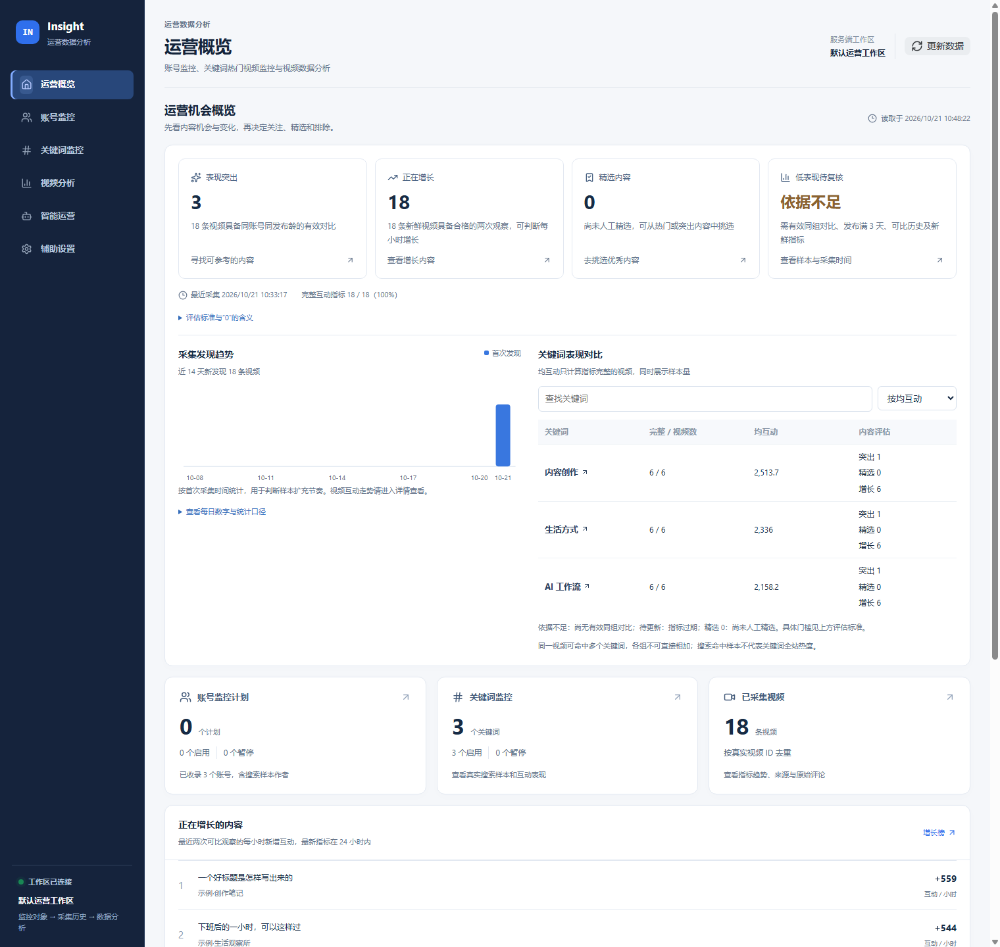
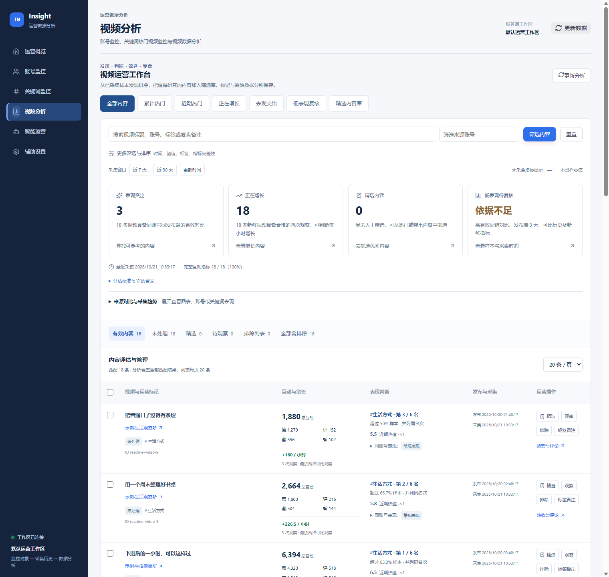
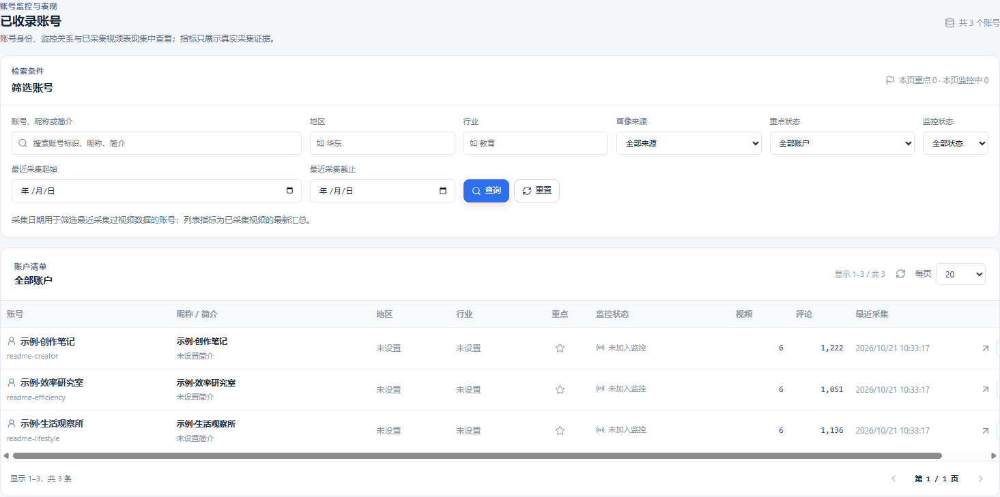

# wx_channel_insight

微信视频号运营数据分析工具。通过独立运行的 `wx_channel` 数据面采集数据，在 Insight 中管理账号与关键词监控，查看视频表现、指标变化与评论洞察。

后端使用 Go，前端使用 Vue 3、Vite 和 Naive UI。支持 SQLite、PostgreSQL、JSON 文件和内存存储，可在本机运行，也可通过 Docker 部署。AI 分析按需配置，未配置 AI 时仍可使用监控与数据查询功能。

## 主要功能

| 功能 | 说明 |
| --- | --- |
| 运营概览 | 汇总监控计划、已收录账号和视频，查看内容表现与增长机会 |
| 账号监控 | 管理账号、配置监控计划，查看账号详情、视频列表与采集历史 |
| 关键词监控 | 按关键词建立周期搜索计划，比较搜索样本的互动表现 |
| 视频分析 | 按账号、关键词和时间筛选视频，查看点赞、评论、收藏、转发及可比较的指标变化 |
| 智能运营 | 根据已有数据生成 AI 分析，辅助判断值得关注的内容 |
| 辅助设置 | 检查采集连接、运行状态，配置 AI 服务及提示词 |

指标以采集源实际返回的数据为准；缺失指标与样本不足时的增长结论会在界面中标明。

## 项目截图

以下截图来自当前版本的实际前端，使用隔离环境生成的虚构账号、视频和指标，仅用于展示界面，不代表真实运营结果。

### 运营概览

集中查看内容机会、监控计划和视频收录情况，通过表现与增长信息进入对应的视频分析。



<details>
<summary>查看视频分析截图</summary>

按来源、关键词和时间筛选视频，结合互动指标与多次采集结果，判断内容表现及变化。



</details>

<details>
<summary>查看账号监控截图</summary>

下图为账号库区域。按账号、地区、行业和监控状态筛选已收录账号，查看视频与评论汇总，并从列表进入账号详情。



</details>

## 本地快速启动

需要 Go 1.25+、Node.js 22+ 和 npm。以下命令在项目根目录的 PowerShell 中执行：

```powershell
Copy-Item config.example.json insight.local.json
Set-Location apps/web
npm ci
npm run build
Set-Location ../..
go run ./apps/api
```

打开启动日志中的本地地址，默认 <http://127.0.0.1:18081/>。模板使用 SQLite，数据库位于 `var/insight.db`，无需安装 PostgreSQL 或 Redis。模板启用本机 operator，只能用于本机访问。

另开一个终端，在同一项目目录启动监控调度：

```powershell
go run ./apps/scheduler
```

真实采集需要另外启动 `wx_channel`，默认连接 `http://127.0.0.1:2026`，视频号客户端需处于就绪状态。Insight 不包含该程序或其登录会话。

## 配置与存储

API、jobs 和 scheduler 共用 JSON 配置。默认读取当前工作目录的 `insight.local.json`，也可指定：

```powershell
$env:INSIGHT_CONFIG_FILE = 'C:\opt\insight\insight.local.json'
```

优先级为环境变量 > JSON > 内置默认值。JSON 中的相对文件路径以配置文件所在目录解析；环境变量中的相对路径以进程工作目录解析。公开字段及环境变量映射见 [配置实现](internal/runtime/config_file.go)。配置字段拼写错误、重复字段或类型错误会阻止启动。

| 方式 | `storage.driver` | 用途 |
| --- | --- | --- |
| SQLite | `sqlite` | 本机持久存储，默认公开模板 |
| PostgreSQL | `postgres` | 服务端/团队部署，参考 `config.postgres.example.json` |
| JSON 文件 | `file` | 按模块保存 JSON，数据位于 `storage.data_dir` |
| 内存 | `memory` | 临时演示和测试，重启不保留 |

`stores` 可覆盖单个模块的驱动与路径；通常只需设置统一的 `storage.driver`。切换驱动不会自动搬迁数据。JSON 文件须使用当前数据结构；文件存储迁移到 PostgreSQL 的预检和导入入口见 [迁移工具](apps/jobs/migrate_file_store.go)，导入仅接受空目标数据库，操作前应备份原始文件。

PostgreSQL 模板中的 DSN 和桥接 token 需要自行配置。运行 `go run ./apps/jobs bootstrap-schema` 初始化迁移后再启动 API。面向浏览器的团队部署使用服务端可信代理，参考 [Docker 部署](deploy/stack/DEPLOYMENT.md)。共享 operator 部署没有独立用户登录体系；对外服务还需部署方配置访问控制。

AI 密钥通过 `OPENAI_API_KEY` 或本地配置提供；在设置中持久保存 AI 服务配置时需设置 `INSIGHT_AI_CONFIG_ENCRYPTION_KEY`（64 位十六进制）。本地配置、密钥和运行数据库不进入 Git 或分发包。

## 使用运行包

- [Windows 运行包](deploy/windows/README.md)：解压后启动 API 与 scheduler，首次启动生成本地配置。
- [Docker 源码包部署](deploy/stack/DEPLOYMENT.md)：联网构建镜像，运行 PostgreSQL、Redis、API、Web 和 scheduler。
- [Docker 离线包部署](deploy/stack/DEPLOYMENT-OFFLINE.md)：使用已导出的 Linux 镜像，无需现场编译。

## 构建与验证

以下命令在项目根目录执行：

```powershell
# 后端测试
go test ./...

# 前端测试与生产构建（首次使用先执行 npm ci）
Set-Location apps/web
npm test
npm run build
Set-Location ../..

# 构建 Windows 运行目录包
.\scripts\windows\build-insight-preview.ps1

# 构建 Docker 源码 ZIP
.\scripts\windows\build-insight-docker-package.ps1
```

Windows 构建需要 Go、Node.js 和 npm；Docker 源码包在部署时构建镜像。默认产物位于 `release/`。离线镜像包使用 `build-insight-docker-offline-package.ps1`，需显式指定已经验证的 API/Web 镜像，参数见 [脚本入口](scripts/README.md)。

## 项目结构

| 路径 | 职责 |
| --- | --- |
| `apps/api`、`apps/jobs`、`apps/scheduler` | HTTP 服务、一次性任务、周期调度 |
| `apps/web` | Vue 3 + Vite 前端 |
| `internal`、`migrations` | 业务、存储实现与 PostgreSQL 迁移 |
| `scripts` | 运行、构建及诊断脚本 |
| `deploy` | 部署模板及运行包使用说明 |
| `assets/screenshots` | README 使用的项目界面截图 |
| `tests/scripts` | 脚本回归测试 |
| `bin`、`release`、`var` | 本地生成物，均不纳入版本控制 |

脚本用途见 [scripts/README.md](scripts/README.md)，部署与运行方式见 [Windows 运行说明](deploy/windows/README.md) 和 [Docker 部署说明](deploy/stack/README.md)。

## 开源协议

[Apache License 2.0](LICENSE)。使用者需自行确认其数据访问、账号授权及第三方服务的使用条件。
